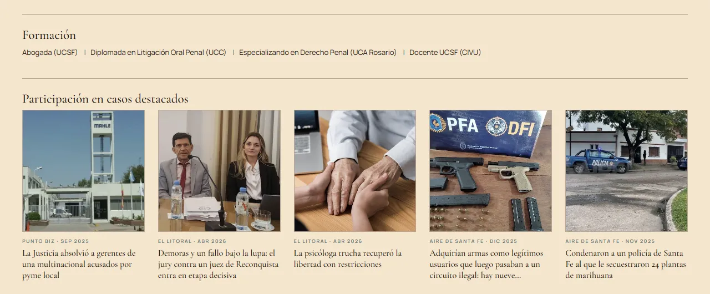

# Antonella Cardozo · Abogada

Sitio web profesional para una abogada penalista de la Ciudad de Santa Fe, Argentina.

**🔗 Web Activa: [abogadasantafe.com.ar](https://abogadasantafe.com.ar)**

<p align="center">
  
</p>

<p align="center">
  
  &nbsp;
  
</p>

## Qué resuelve

Quien busca una abogada penalista suele estar en una situación urgente y no sabe por dónde empezar. El sitio responde rápido las tres preguntas que importan:

- **¿Qué casos lleva?** Derecho Penal como área principal, con seis servicios explicados en lenguaje claro (defensa penal, querella, ejecución penal, régimen penal juvenil, contravenciones y restitución de bienes), y las áreas complementarias aparte.
- **¿Puedo confiar en ella?** Matrículas provincial y federal visibles desde el inicio, formación y notas de prensa de medios locales sobre casos en los que participó.
- **¿Cómo la contacto?** WhatsApp en el menú y en el botón principal, teléfono, urgencias 24/7 y un formulario de mail que se despliega sin salir de la página.

## Funcionalidades

- **Formulario que confirma el envío real:** el mail se manda con [FormSubmit](https://formsubmit.co), sin servidor propio. Como FormSubmit puede responder `200` sin haber enviado nada, el script lee el campo `success` de la respuesta y solo muestra "¡Gracias!" si el mail salió; si no, sugiere escribir por WhatsApp.
- **Protección contra spam sin captcha:** un campo trampa oculto descarta los envíos automáticos sin pedirle nada a la persona.
- **Panel de mail accesible:** el formulario está cerrado con `inert` hasta que se abre, así el teclado y los lectores de pantalla no entran en campos invisibles. Al abrirlo, el foco pasa al primer campo.
- **Animaciones al bajar:** las secciones aparecen con `IntersectionObserver`, una tras otra dentro de cada grupo, y se desactivan con `prefers-reduced-motion`.
- **Menú móvil:** se abre y cierra con el botón, se cierra al elegir una sección o con `Escape`, y actualiza `aria-expanded` y `aria-label`.

## Detalles técnicos


| **Stack** | HTML, CSS y JavaScript sin frameworks, sin dependencias y sin paso de build |
| **Peso** | ~760 KB en lo que descarga la página, con el retrato en WebP (de 610 KB a 37 KB) y PNG solo como respaldo |
| **SEO** | Datos estructurados `schema.org/Attorney` con dirección y coordenadas para búsquedas locales, Open Graph para la vista previa en WhatsApp y redes, y URL canónica |
| **Accesibilidad** | Textos alternativos, menú y formulario con atributos ARIA, mensajes del formulario en una región `aria-live` y respeto de `prefers-reduced-motion` |
| **Hosting** | GitHub Pages con dominio `.com.ar` propio |

Algunas decisiones:

- **Sin framework.** Es una sola página con contenido fijo; React o un generador de sitios agregarían peso y mantenimiento sin aportar nada. El JavaScript completo tiene 140 líneas.
- **WhatsApp primero, mail como alternativa.** WhatsApp es el canal más rápido para una consulta urgente, pero es importante ofrecer todos los medios de comunicación. El formulario queda escondido detrás de un botón para no competir con la acción principal.
- **El nombre del inicio es un SVG.** El título tipográfico de la marca se exportó como SVG para que se vea igual en todos los dispositivos, con `alt` para buscadores y lectores de pantalla.

## Estructura

```
├── index.html        Página única: inicio, perfil, derecho penal, otras áreas y contacto
├── styles.css        Estilos, con variables de color y tipografía en :root
├── script.js         Menú, animaciones al bajar y formulario de mail
├── img/              Retrato, fondo, logo, favicon, vista previa e imágenes de prensa
├── docs/             Capturas para este README
└── CNAME             Dominio propio para GitHub Pages
```


```bash
npx serve .
```

## Autoría

Diseño y desarrollo: **[Quantum Dev](https://www.instagram.com/developerquantum/)**. de Leguizamón Francis.

El nombre, las fotos, el logo y los textos pertenecen a Antonella Cardozo y no pueden reutilizarse. Las imágenes de prensa pertenecen a sus respectivos medios. El código está publicado como muestra de trabajo.
